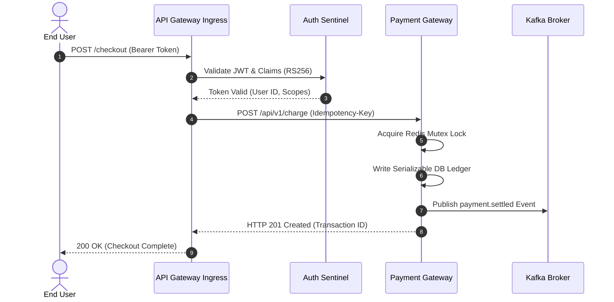

# Checkout & Identity Mesh Distributed Architecture

This section documents the end-to-end communication topology, distributed transaction mechanics, and messaging backbones connecting all microservices within **Checkout & Identity Mesh**.

## Inter-Service Communication Matrix

| Source Service | Target Service | Interaction Type | Protocol / Topic | Purpose & Flow |
| :--- | :--- | :--- | :--- | :--- |
| [Payment Gateway Service](/wiki/payment-gateway/overview) | [Auth Sentinel Service](/wiki/auth-sentinel/overview) | `Synchronous RPC` | gRPC | Token validation and user context |

## End-to-End Request Lifecycle

## Messaging Backbone & Event Catalog

Asynchronous decoupling is enforced through message broker topics. Services publish immutable domain events without knowledge of downstream subscribers:

| Topic Name | Producer Microservice | Broker Transport | Business Domain Meaning |
| :--- | :--- | :--- | :--- |
| `auth-sentinel.events` | [Auth Sentinel Service](/wiki/auth-sentinel/overview) | Apache Kafka / Event Bus | Broadcasts state changes |
| `payment-gateway.events` | [Payment Gateway Service](/wiki/payment-gateway/overview) | Apache Kafka / Event Bus | Broadcasts state changes |

## Distributed Data Consistency & Sagas

- **Dual-Entry Ledger**: Financial mutations use strict serializable isolation within [Auth Sentinel Service](/wiki/auth-sentinel/overview).
- **Compensating Transactions**: Failed downstream calls trigger reverse compensation events to unwind intermediate allocations.
- **Read-Your-Writes Consistency**: Cache invalidations are broadcast synchronously over Redis Pub/Sub.
