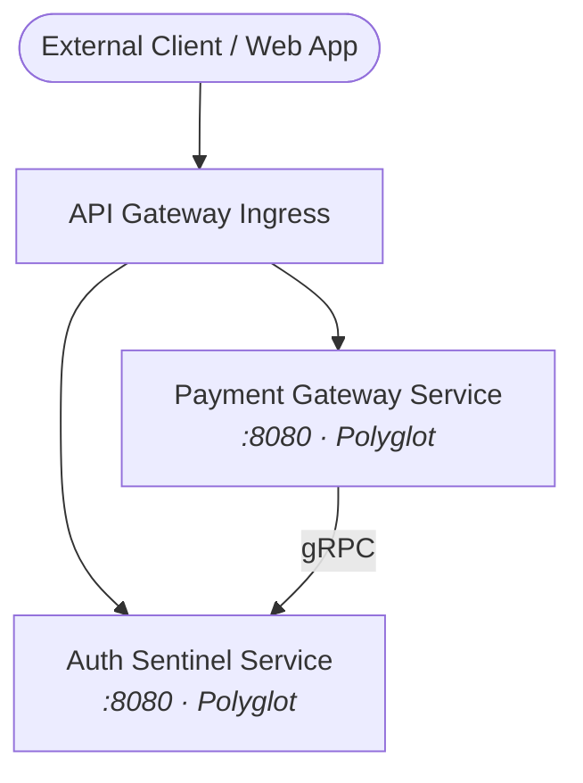

# Checkout & Identity Mesh Overview

The **Checkout & Identity Mesh** is a federated multi-repository microservice ecosystem. Each service is encapsulated in an isolated repository with dedicated build boundaries, independent data stores, and explicit transport contracts.

## Microservice Inventory Matrix

Every microservice in this ecosystem maintains dedicated documentation. Select any service to explore its internal architecture, invariants, and implementation contracts:

| Microservice | Repository | Language | Port | Datastores | Core Routes |
| :--- | :--- | :--- | :--- | :--- | :--- |
| [Auth Sentinel Service](/wiki/auth-sentinel/overview) | `auth-sentinel` | `Polyglot` | `8080` | Redis | `/health`, `/api/v1/auth-sentinel` |
| [Payment Gateway Service](/wiki/payment-gateway/overview) | `payment-gateway` | `Polyglot` | `8080` | PostgreSQL, Redis, Kafka | `/api/v1/payments`, `/api/v1/payments/{payment_id}/refunds`, `/api/v1/payments/{paymentid}/refunds` |

## Federated System Architecture

## System Responsibilities & Boundaries

- **Separation of Concerns**: Domain models are strictly isolated. No service accesses another microservice's datastore directly.
- **Contract Enforcement**: Service communication conforms to explicit REST, gRPC, or event payload schemas.
- **Edge Routing**: External client traffic reaches internal microservices exclusively through an API gateway layer.
- **Unified Observability**: All member repositories propagate `X-Correlation-ID` and OpenTelemetry trace context headers.

## Cross-Service Invariants

1. **Zero Direct DB Access**: Cross-domain queries are executed via RPCs or asynchronous event stream materialized views.
2. **Distributed Idempotency**: Inter-service mutative calls carry unique idempotency keys to guarantee at-most-once execution across retries.
3. **Graceful Degraded State**: If a peer service is unreachable, calling services employ circuit breakers and fallback defaults.
